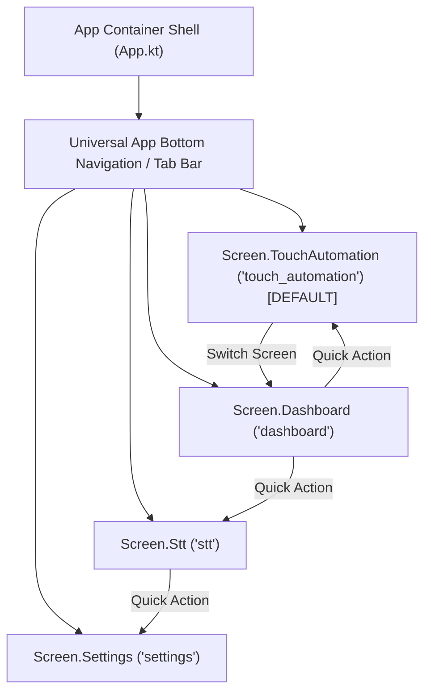

# AGENTS.md — AI Agent Guide to TTSAIController

Welcome to **TTSAIController**. This document is specifically structured to provide autonomous AI agents, coding assistants (Gemini, Claude, GPT, Cursor), and automated execution scripts with an immediate, unambiguous understanding of the system architecture, navigation, testing protocols, AI model integration points, and **RTK (Rust Token Killer)** token optimization for autonomous agent workflows.

---

## 1. System Overview & Mental Model

`TTSAIController` is a cross-platform Text-To-Speech / Speech-To-Text and Touch Automation orchestrator built with **Kotlin Multiplatform (KMP)** and **Compose Multiplatform** targeting **Android**, **Desktop (JVM)**, and **iOS**.

### Architectural Invariants:
1. **Layered Modular Feature-Based Clean Architecture**:
   - Every feature is self-contained under `com.vampyrelord.ttsaicontroller.features.<feature_name>`.
   - Clear unidirectional dependencies: **Presentation → Domain ← Data**.
   - The **Domain layer** contains zero framework, Android, or Compose dependencies.
2. **Model-View-Intent (MVI) with Clean State Hoisting**:
   - **`State`**: Single, immutable data class representing the complete screen state.
   - **`Intent`**: Sealed interface representing all user or agent interactions dispatched to the ViewModel.
   - **`Effect`**: Sealed interface representing transient one-off side effects (dialog triggers, toasts, navigation).
   - ViewModels inherit from [`BaseMviViewModel<State, Intent, Effect>`](file:///shared/src/commonMain/kotlin/com/vampyrelord/ttsaicontroller/core/architecture/BaseMviViewModel.kt).
   - **Compose Hoisting**: Composable screen content functions accept immutable state and event lambda callbacks (`onIntent: (Intent) -> Unit`), never raw ViewModels.
3. **Compose Multiplatform with Least Differences**:
   - 100% of the UI screens, design system, theme, and navigation live in `shared/src/commonMain`.
   - Platform entry points (`androidApp/MainActivity.kt`, `desktopApp/main.kt`, `iosApp/MainViewController.kt`) only call `App()`.
4. **Token-Optimized Agent Workflows (RTK)**:
   - For autonomous agents interacting with this repo via CLI, use **RTK (Rust Token Killer)** to compress build and test outputs by 60–90%, preserving LLM context windows and avoiding token exhaustion.

---

## 2. Basic Requirements & Prerequisites

| Requirement | Supported Version / Target | Notes |
| :--- | :--- | :--- |
| **JDK** | Java 17+ (Java 21 recommended) | Toolchain managed by Foojay resolver |
| **Gradle** | 9.5.1+ (via `./gradlew` wrapper) | Configuration caching & build cache enabled |
| **Kotlin** | 2.4.20 | Multiplatform |
| **Compose Multiplatform** | 1.12.1 | Material 3 Alpha 03 |
| **Android Compile SDK** | 37 (Min: 24, Target: 37) | Android Studio Hedgehog or newer |
| **Desktop Runtime** | Java JVM (Windows, macOS, Linux) | Native mouse automation via `java.awt.Robot` |
| **iOS Target** | iOS 14.0+ (Simulator Arm64, Device) | Xcode 15+ on macOS |

---

## 3. Navigation Graph & Screen Routes

Navigation is managed via [`Navigator`](file:///shared/src/commonMain/kotlin/com/vampyrelord/ttsaicontroller/core/navigation/Navigation.kt) emitting `StateFlow<Screen>`:



### Route Definitions:
| Screen | Route ID | Title | Purpose |
| :--- | :--- | :--- | :--- |
| **`Screen.TouchAutomation`** | `"touch_automation"` | `Touch Automation` | **Default startup screen**. Configures, visualizes, and executes touch/click automation routines with Rushwulf settings, automatic point placement (Grid, Circular, Column, Row, Spread), and runtime permissions. |
| **`Screen.Dashboard`** | `"dashboard"` | `Dashboard` | Real-time system status, automation execution metrics, audio routing counters, and quick triggers. |
| **`Screen.Stt`** | `"stt"` | `Speech To Text` | AI-ready Speech-to-Text interface with recording controls, audio file transcription, transcription history, and model configuration placeholders. |
| **`Screen.Settings`** | `"settings"` | `Settings` | Theme switcher (Light/Dark/System), Rushwulf automation defaults (step delay, tap duration, repeat counts), and audio routing diagnostics. |

---

## 4. RTK (Rust Token Killer) for AI Agents

When AI agents (Gemini, Claude, GPT, Cursor, Antigravity) run terminal commands (such as Gradle builds, test suites, and git inspections), raw terminal outputs frequently contain tens of thousands of tokens of repetitive log lines, UP-TO-DATE task trees, and ANSI escape codes.

**RTK (`rtk-ai/rtk`)** is a dedicated CLI tool designed to compress command line output for LLM context windows without losing any errors or relevant diagnostic information.

### Installing RTK:
```bash
# Via Cargo (Rust toolchain)
cargo install rtk-ai

# Via Windows Winget
winget install rtk-ai.rtk

# Via Homebrew (macOS/Linux)
brew install rtk-ai/tap/rtk
```

### Recommended RTK Usage for Agents:
AI agents should prefix terminal verification commands with `rtk` to save 60–90% of context tokens:

```bash
# Running Gradle tests via RTK
rtk ./gradlew :shared:jvmTest
rtk ./gradlew :shared:testAndroidHostTest

# Inspecting Git status and diffs via RTK
rtk git status -s
rtk git diff

# Compiling builds via RTK
rtk ./gradlew :desktopApp:assemble
rtk ./gradlew :androidApp:assembleDebug
```

### Why RTK is Required for AI Agents:
- **Reduces Context Drift**: Prevents massive build logs from pushing system instructions or design rules out of context.
- **Pinpoints Failures**: RTK strips successful tests and boilerplate UP-TO-DATE tasks, highlighting only failing assertions and exceptions.
- **Token Efficiency**: Reduces multi-megabyte terminal payloads down to concise summaries.

---

## 5. Speech-To-Text (STT) AI Model Integration Guide

The Speech-To-Text feature (`com.vampyrelord.ttsaicontroller.features.stt`) provides clean, unopinionated domain interfaces prepared for plug-and-play AI model integration (e.g., Whisper, Google Gemini Live / Speech API, Sherpa-ONNX, or Vosk):

### Architecture of STT:
```
shared/src/commonMain/kotlin/com/vampyrelord/ttsaicontroller/features/stt/
├── domain/
│   ├── model/         // SttTranscription, SttConfig, SttAudioChunk, TranscriptionStatus
│   ├── repository/    // SpeechToTextRepository (clean interface)
│   └── usecase/       // StartSpeechToTextUseCase, StopSpeechToTextUseCase, TranscribeAudioUseCase, etc.
├── data/
│   └── repository/    // PendingAiSpeechToTextRepository (placeholder returning clean AppResult)
└── presentation/
    ├── SttScreen.kt   // Compose Multiplatform UI
    ├── SttViewModel.kt// MVI ViewModel
    └── mvi/           // SttMvi (State, Intent, Effect)
```

### Connecting an AI Engine:
To plug in a real AI transcription model:
1. Implement [`SpeechToTextRepository`](file:///shared/src/commonMain/kotlin/com/vampyrelord/ttsaicontroller/features/stt/domain/repository/SpeechToTextRepository.kt) in `data/repository/` (e.g. `WhisperSpeechToTextRepository` or `GeminiLiveSpeechToTextRepository`).
2. Swap the binding in [`AppContainer.kt`](file:///shared/src/commonMain/kotlin/com/vampyrelord/ttsaicontroller/core/di/AppContainer.kt):
   ```kotlin
   val speechToTextRepository: SpeechToTextRepository = YourAiSpeechToTextRepository(...)
   ```
3. Zero changes are needed in Domain use cases or Compose UI screens.

---

## 6. How Agents Should Add New Features

When extending the codebase, agents must strictly follow Clean Architecture + MVI:

```
features/<feature_name>/
├── domain/
│   ├── model/         // Pure Kotlin immutable models
│   ├── repository/    // Repository interfaces (no data source dependencies)
│   └── usecase/       // Single-responsibility use cases returning AppResult<T>
├── data/
│   ├── datasource/    // InMemory, Network, or Engine data sources
│   └── repository/    // Repository implementations
└── presentation/
    ├── mvi/           // State, Intent, Effect sealed hierarchies
    ├── <Feature>ViewModel.kt  // Extends BaseMviViewModel<State, Intent, Effect>
    └── <Feature>Screen.kt     // Pure Compose Multiplatform UI (accepts state & callbacks)
```

### Steps:
1. **Domain**: Define models and repository interface under `domain/`.
2. **Use Case**: Encapsulate business logic in `domain/usecase/`. Return `AppResult<T>`.
3. **Data**: Implement repository under `data/repository/`.
4. **MVI Presentation**: Create `FeatureState`, `FeatureIntent`, `FeatureEffect` in `presentation/mvi/`.
5. **ViewModel**: Extend `BaseMviViewModel`, collect flows in `viewModelScope`, and implement `handleIntent`.
6. **Compose Screen**: Build pure Compose UI accepting `state: FeatureState` and `onIntent: (FeatureIntent) -> Unit`.
7. **Service Locator**: Expose the new feature in [`AppContainer.kt`](file:///shared/src/commonMain/kotlin/com/vampyrelord/ttsaicontroller/core/di/AppContainer.kt).
8. **Navigation**: Add route to [`Screen.kt`](file:///shared/src/commonMain/kotlin/com/vampyrelord/ttsaicontroller/core/navigation/Navigation.kt) and [`App.kt`](file:///shared/src/commonMain/kotlin/com/vampyrelord/ttsaicontroller/App.kt).

---

## 7. Verification & Build Commands

Before marking any agent task complete, execute and verify:

```bash
# 1. Run common & JVM unit tests (100% pass)
./gradlew :shared:jvmTest

# 2. Run Android host unit tests (100% pass)
./gradlew :shared:testAndroidHostTest

# 3. Compile Desktop Application
./gradlew :desktopApp:assemble

# 4. Compile Android Application
./gradlew :androidApp:assembleDebug
```
