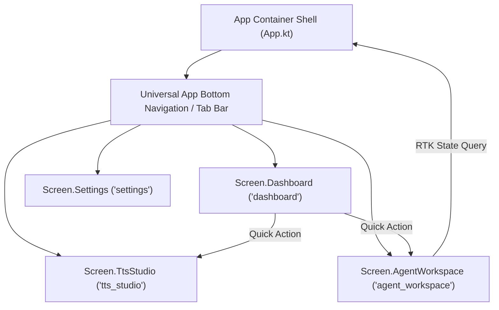

# AGENTS.md — AI Agent Guide to TTSAIController

Welcome to **TTSAIController**. This document is specifically structured to provide autonomous AI agents, coding assistants (Gemini, Claude, GPT), and automated execution agents with an immediate, unambiguous understanding of the system architecture, requirements, navigation, and runtime integration protocols.

---

## 1. System Overview & Mental Model

`TTSAIController` is a cross-platform Text-To-Speech (TTS) orchestrator and controller built with **Kotlin Multiplatform (KMP)** and **Compose Multiplatform**.

### Architectural Invariants:
1. **Layered Modular Feature-Based Clean Architecture**:
   - Every feature is self-contained under `com.vampyrelord.ttsaicontroller.features.<feature_name>`.
   - Clear unidirectional dependencies: **Presentation → Domain ← Data**.
   - The **Domain layer** contains zero framework, Android, or Compose dependencies.
2. **Model-View-Intent (MVI) for All Screens**:
   - **`State`**: Single, immutable data class representing the complete screen state.
   - **`Intent`**: Sealed interface representing all user or agent interactions dispatched to the ViewModel.
   - **`Effect`**: Sealed interface representing transient one-off side effects (toasts, alerts, triggers).
   - ViewModels inherit from [`BaseMviViewModel<State, Intent, Effect>`](file:///shared/src/commonMain/kotlin/com/vampyrelord/ttsaicontroller/core/architecture/BaseMviViewModel.kt).
3. **Compose Multiplatform with Least Differences**:
   - 100% of the UI screens, design system, theme, and navigation live in `shared/src/commonMain`.
   - Platform entry points (`androidApp/MainActivity.kt`, `desktopApp/main.kt`, `iosApp/MainViewController.kt`) only call `App()`.
4. **RTK (Redux Toolkit & Agent Runtime Kit)**:
   - Centralized Redux store with slices, reducers, middleware, and typed action dispatchers.
   - Autonomous Agent Tool Registry: exposes structured tools for LLMs and autonomous scripts to discover, query state, and execute commands against the TTS engine.

---

## 2. Basic Requirements & Prerequisites

| Requirement | Supported Version / Target | Notes |
| :--- | :--- | :--- |
| **JDK** | Java 17+ (Java 21 recommended) | Toolchain managed by Foojay resolver |
| **Gradle** | 9.5.1+ (via `./gradlew` wrapper) | Configuration caching & build cache enabled |
| **Kotlin** | 2.4.20 | Multiplatform |
| **Compose Multiplatform** | 1.12.1 | Material 3 Alpha 03 |
| **Android Compile SDK** | 37 (Min: 24, Target: 37) | Android Studio Hedgehog or newer |
| **Desktop Runtime** | Java JVM (Windows, macOS, Linux) | Run via `:desktopApp:run` |
| **iOS Target** | iOS 14.0+ (Simulator Arm64, Device) | Xcode 15+ on macOS |

---

## 3. Navigation Graph & Screen Routes

Navigation is managed via [`Navigator`](file:///shared/src/commonMain/kotlin/com/vampyrelord/ttsaicontroller/core/navigation/Navigation.kt) emitting `StateFlow<Screen>`:



### Route Definitions:
| Screen | Route ID | Title | Purpose |
| :--- | :--- | :--- | :--- |
| **`Screen.Dashboard`** | `"dashboard"` | `Dashboard` | Real-time system status, audio waveform, KPI counters, and quick actions. |
| **`Screen.TtsStudio`** | `"tts_studio"` | `TTS Studio` | Speech text input, voice selection, modulation sliders (pitch, rate, volume), audio controls, and queue/history. |
| **`Screen.AgentWorkspace`** | `"agent_workspace"` | `Agent RTK` | Agent persona selector, command prompt console, interactive tool runners, live RTK state slices, and audit log. |
| **`Screen.Settings`** | `"settings"` | `Settings` | Theme switcher (Light/Dark/System), autonomous agent toggles, audio sink hardware routing, and platform diagnostics. |

---

## 4. RTK (Redux Toolkit & Agent Runtime Kit) Reference

The project provides an RTK implementation specifically designed for agent interaction:

### Central Store:
- **Location**: [`com.vampyrelord.ttsaicontroller.core.rtk.RtkStore`](file:///shared/src/commonMain/kotlin/com/vampyrelord/ttsaicontroller/core/rtk/RtkStore.kt)
- **Active Slices**:
  - `tts`: Tracks `isSpeaking`, `isPaused`, `activeJobId`, `lastAction`.
  - `agent`: Tracks `executedActionsCount`, `lastToolExecuted`.
  - `settings`: Tracks system theme, auto-play, and audio routing modes.

### Available Agent RTK Tools:
All tools implement [`AgentTool`](file:///shared/src/commonMain/kotlin/com/vampyrelord/ttsaicontroller/core/rtk/AgentTool.kt) and are registered in [`AgentToolRegistry`](file:///shared/src/commonMain/kotlin/com/vampyrelord/ttsaicontroller/core/rtk/AgentToolRegistry.kt):

#### 1. `speak_text`
- **Category**: `TTS_CONTROL`
- **Description**: Synthesize and speak specified text with specified voice and speed.
- **Parameters**:
  ```json
  {
    "text": { "type": "string", "required": true, "description": "Text to speak" },
    "voiceId": { "type": "string", "required": false, "description": "Optional voice ID (e.g. voice-aria, voice-nova)" },
    "pitch": { "type": "number", "required": false, "default": 1.0, "range": [0.5, 2.0] },
    "rate": { "type": "number", "required": false, "default": 1.0, "range": [0.5, 2.5] }
  }
  ```

#### 2. `stop_speech`
- **Category**: `TTS_CONTROL`
- **Description**: Immediately stop active playback and clear the active audio channel.
- **Parameters**: None.

#### 3. `pause_speech`
- **Category**: `TTS_CONTROL`
- **Description**: Temporarily pause speech audio playback.
- **Parameters**: None.

#### 4. `resume_speech`
- **Category**: `TTS_CONTROL`
- **Description**: Resume paused speech audio playback.
- **Parameters**: None.

#### 5. `get_playback_status`
- **Category**: `SYSTEM_INSPECTION`
- **Description**: Query playback status (`isSpeaking`, `isPaused`, `activeJobText`, `queueSize`).
- **Parameters**: None.

#### 6. `list_voices`
- **Category**: `SYSTEM_INSPECTION`
- **Description**: Retrieve available neural and standard voice models and languages.
- **Parameters**: None.

#### 7. `query_state_slice`
- **Category**: `RTK_STORE`
- **Description**: Inspect a Redux state slice.
- **Parameters**:
  ```json
  {
    "sliceName": { "type": "string", "required": true, "description": "Slice name ('tts', 'agent', etc.)" }
  }
  ```

#### 8. `dispatch_rtk_action`
- **Category**: `RTK_STORE`
- **Description**: Dispatch an arbitrary Redux Toolkit action into the store.
- **Parameters**:
  ```json
  {
    "type": { "type": "string", "required": true, "description": "Action type identifier (e.g. 'agent/custom_event')" },
    "payload": { "type": "string", "required": false, "description": "Payload data" }
  }
  ```

---

## 5. How Agents Should Add New Features

When extending the codebase, agents must strictly follow the Clean Architecture + MVI pattern:

```
features/<feature_name>/
├── domain/
│   ├── model/         // Pure Kotlin immutable models
│   ├── repository/    // Repository interfaces (no data source dependencies)
│   └── usecase/       // Single-responsibility use cases
├── data/
│   ├── datasource/    // InMemory, Network, or Engine data sources
│   └── repository/    // Repository implementations (dispatch RTK actions on mutation)
└── presentation/
    ├── mvi/           // State, Intent, Effect data structures
    ├── <Feature>ViewModel.kt  // Extends BaseMviViewModel<State, Intent, Effect>
    └── <Feature>Screen.kt     // Compose Multiplatform UI
```

### Steps:
1. **Domain**: Define models and repository interface under `domain/`.
2. **Use Case**: Encapsulate business logic in `domain/usecase/`. Return `AppResult<T>`.
3. **Data**: Implement repository under `data/repository/` and inject RTK store to dispatch actions.
4. **MVI Presentation**: Create `FeatureState`, `FeatureIntent`, `FeatureEffect` in `presentation/mvi/`.
5. **ViewModel**: Extend `BaseMviViewModel`, collect flows in `viewModelScope`, and implement `handleIntent`.
6. **Compose Screen**: Build pure Compose UI accepting `viewModel` and collecting `viewModel.state`.
7. **Service Locator**: Expose the new feature in [`AppContainer.kt`](file:///shared/src/commonMain/kotlin/com/vampyrelord/ttsaicontroller/core/di/AppContainer.kt).
8. **Navigation**: Add route to [`Screen.kt`](file:///shared/src/commonMain/kotlin/com/vampyrelord/ttsaicontroller/core/navigation/Navigation.kt) and [`App.kt`](file:///shared/src/commonMain/kotlin/com/vampyrelord/ttsaicontroller/App.kt).

---

## 6. Verification & Build Commands

Before marking any agent task complete, execute:

```bash
# 1. Run common & JVM unit tests
./gradlew :shared:jvmTest

# 2. Compile Desktop Application
./gradlew :desktopApp:assemble

# 3. Compile Android Application
./gradlew :androidApp:assembleDebug
```
