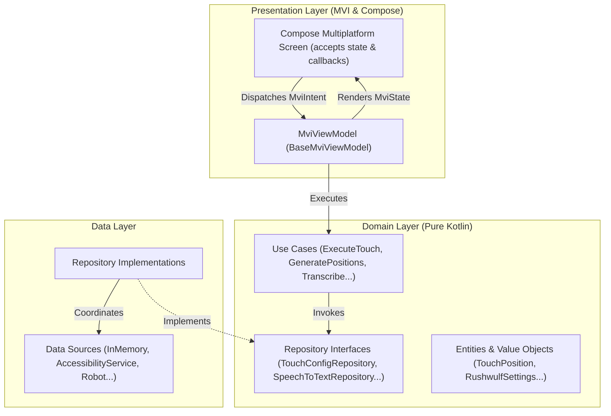
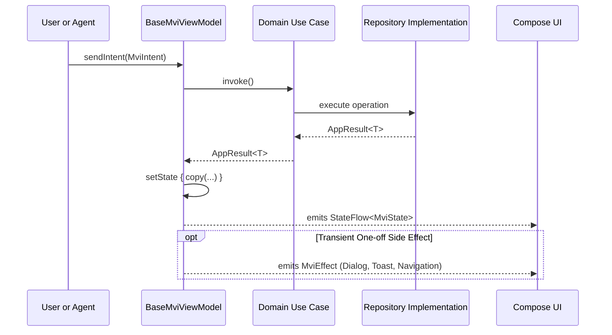

# TTSAIController (Touch & Speech-To-Text AI Controller)

> A modern **Kotlin Multiplatform (KMP)** and **Compose Multiplatform** application implementing **Layered Modular Feature-Based Clean Architecture** with **Model-View-Intent (MVI)** across all screens, reusable touch automation with Rushwulf settings, Speech-To-Text AI model contracts, and **RTK (Rust Token Killer)** token-reduction optimization for AI coding agents.

---

## 🌟 Highlights & Key Principles

- **Layered Modular Feature-Based Clean Architecture**:
  - Unidirectional dependencies: **Presentation → Domain ← Data**.
  - Encapsulated feature modules: `touch`, `dashboard`, `stt` (Speech-to-Text), and `settings`.
  - The **Domain layer** is 100% pure Kotlin with zero UI, Android, or Compose dependencies.
- **Model-View-Intent (MVI) with Clean State Hoisting**:
  - Single immutable `State`, sealed `Intent` actions, and transient one-off `Effect` side-effects.
  - ViewModels inherit from [`BaseMviViewModel`](file:///shared/src/commonMain/kotlin/com/vampyrelord/ttsaicontroller/core/architecture/BaseMviViewModel.kt).
  - UI composables receive immutable state and lambda callbacks (`onIntent`), never raw ViewModel instances.
- **Compose Multiplatform (Least Differences)**:
  - 100% of the UI screens, theme, design components, and navigation live in `shared/src/commonMain`.
  - Platform targets (`androidApp`, `desktopApp`, `iosApp`) simply launch the root `App()` composable.
- **Touch & Gesture Automation with Rushwulf Settings**:
  - Dynamic touch points, coordinate validation, sequence reordering, and Canvas-rendered interactive preview.
  - Multi-point automatic placement algorithms: `GRID`, `CIRCULAR`, `VERTICAL_COLUMN`, `HORIZONTAL_ROW`, `SPREAD`.
  - Full Rushwulf profile settings integration (step delay, tap duration, repeat counts, overlay toggles).
- **Platform-Native Input Automation & Security**:
  - **Android**: Uses system `AccessibilityService` (`TouchAutomationAccessibilityService`) with `dispatchGesture()` and stroke paths. Features explicit runtime permission dialogs before automation starts.
  - **Desktop (JVM)**: Uses native `java.awt.Robot` for pixel-accurate click, double-click, long-press, and wheel scrolling.
  - **iOS**: Pure Kotlin multiplatform sandbox fallback.
- **Speech-To-Text (STT) AI Model Ready**:
  - Shared domain interfaces and use cases ready for on-device or cloud AI models (Whisper, Gemini Live API, Sherpa-ONNX).
  - Clean separation: data layer stubs provide graceful responses while contracts are completely wired and tested.
- **RTK (Rust Token Killer) for AI Agents**:
  - Guidelines and integration for external CLI token reduction to prune 60–90% of Gradle and Git terminal noise for AI agents.
- **100% Test Coverage**:
  - Comprehensive unit test suites covering all Use Cases, MVI ViewModels, Compose screen contracts, and automation controllers across JVM and Android Host.

---

## 🏗️ Clean Architecture Overview



---

## 🔄 MVI State Flow Pattern



---

## 🧭 Navigation & Screen Routes

Managed by [`Navigator`](file:///shared/src/commonMain/kotlin/com/vampyrelord/ttsaicontroller/core/navigation/Navigation.kt) emitting `StateFlow<Screen>`:

1. **Touch Automation** (`"touch_automation"`): **Default initial startup screen**. Interactive Canvas touch-point preview, manual & automatic placement (Grid, Circular, Column, Row, Spread), coordinate validation, sequence reordering, Rushwulf profile settings, and Confirm-and-Start / Stop execution controls.
2. **Dashboard** (`"dashboard"`): Real-time automation metrics, active execution state, audio routing status, and quick trigger actions.
3. **Speech-To-Text** (`"stt"`): Speech-to-Text workspace prepared for AI model integration, audio recording controls, audio file transcription, and history.
4. **Settings** (`"settings"`): System theme (Dark/Light/System), audio output hardware routing, and Rushwulf automation defaults.

---

## 🤖 RTK (Rust Token Killer) for AI Agents

When AI agents (Gemini, Claude, GPT, Cursor, Antigravity) work on this codebase, terminal logs from Gradle and Git can quickly consume context tokens.

**RTK (`rtk-ai/rtk`)** is an ultra-fast CLI proxy that filters out ANSI codes, repetitive UP-TO-DATE task trees, and boilerplate passing tests, reducing prompt size by **60–90%**.

### Installation:
```bash
# Via Cargo
cargo install rtk-ai

# Via Winget (Windows)
winget install rtk-ai.rtk

# Via Homebrew (macOS/Linux)
brew install rtk-ai/tap/rtk
```

### Usage:
Wrap any command with `rtk`:
```bash
# Tests
rtk ./gradlew :shared:jvmTest
rtk ./gradlew :shared:testAndroidHostTest

# Git & Builds
rtk git status -s
rtk git diff
rtk ./gradlew :androidApp:assembleDebug
```

---

## 📁 Package & Directory Structure

```
TTSAIController/
├── androidApp/                     // Android application entry point (MainActivity)
├── desktopApp/                     // Desktop JVM application entry point (main.kt)
├── iosApp/                         // iOS Xcode application wrapper (MainViewController)
└── shared/                         // Core shared Compose Multiplatform module
    └── src/
        ├── commonMain/kotlin/com/vampyrelord/ttsaicontroller/
        │   ├── App.kt             // Universal App shell & Adaptive layout
        │   ├── Platform.kt        // Platform abstraction interface
        │   │
        │   ├── core/
        │   │   ├── architecture/  // Base MVI contracts, BaseMviViewModel, AppResult
        │   │   ├── navigation/    // Navigator, Screen routes
        │   │   ├── designsystem/  // Theme, WaveformVisualizer, AppCard, StatusBadge
        │   │   ├── util/          // Cross-platform time utilities
        │   │   └── di/            // AppContainer (Pure Kotlin Service locator)
        │   │
        │   └── features/
        │       ├── touch/         // Feature: Touch Automation & Rushwulf Integration
        │       │   ├── domain/    // Models (TouchPosition, RushwulfSettings), Repository, UseCases
        │       │   ├── data/      // BaseTouchController, InMemoryTouchConfigRepository
        │       │   └── presentation/ // TouchAutomationViewModel, TouchAutomationScreen, MVI
        │       │
        │       ├── dashboard/     // Feature: System metrics & quick actions
        │       │   ├── domain/    // DashboardMetrics, GetDashboardMetricsUseCase
        │       │   └── presentation/ // DashboardViewModel, DashboardScreen, MVI
        │       │
        │       ├── stt/           // Feature: Speech-To-Text AI interface
        │       │   ├── domain/    // Models, SpeechToTextRepository, UseCases
        │       │   ├── data/      // PendingAiSpeechToTextRepository
        │       │   └── presentation/ // SttViewModel, SttScreen, MVI
        │       │
        │       └── settings/      // Feature: Theme switcher, Rushwulf defaults, Audio routing
        │           ├── domain/    // AppSettings, AudioOutputRouting, SettingsRepository, UseCases
        │           ├── data/      // SettingsRepositoryImpl
        │           └── presentation/ // SettingsViewModel, SettingsScreen, MVI
        │
        ├── commonTest/            // 100% Comprehensive Unit & MVI Test Suites
        │   ├── AllUseCasesTest.kt     // Tests all 16 domain use cases
        │   ├── AllViewModelsTest.kt   // Tests all MVI ViewModels, state mutations & effects
        │   ├── ComposeScreensTest.kt  // Tests UI contracts, state hoisting & permissions dialog
        │   ├── TouchAutomationTest.kt // Tests touch algorithms & boundaries
        │   └── FakeTouchController.kt // Reusable controller test fake
        │
        ├── androidMain/           // Android AccessibilityService & platform actuals
        ├── jvmMain/               // Desktop Robot input automation & platform actuals
        └── iosMain/               // iOS platform actuals
```

---

## 🛠️ Prerequisites & Build Commands

- **Java Development Kit (JDK)**: Java 17+ (Java 21 recommended)
- **Gradle**: 9.5.1+ (included via `./gradlew`)
- **Android SDK**: Compile SDK 37 (Minimum SDK 24)

### Running Verification Tests:
```bash
# 1. Run common & JVM unit tests (100% pass)
./gradlew :shared:jvmTest

# 2. Run Android host unit tests (100% pass)
./gradlew :shared:testAndroidHostTest
```

### Compiling Apps:
```bash
# Desktop application
./gradlew :desktopApp:assemble

# Android debug APK
./gradlew :androidApp:assembleDebug
```
