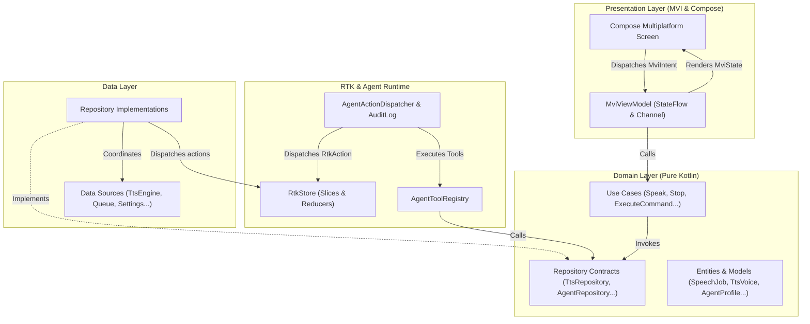
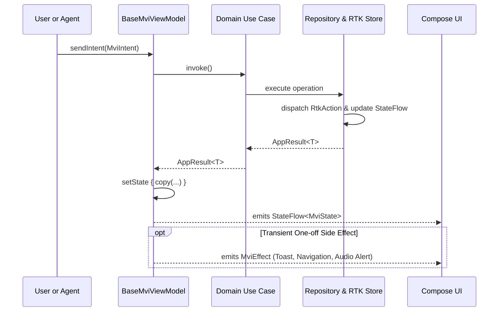

# TTSAIController (Text-to-Speech AI Controller)

> A modern **Kotlin Multiplatform (KMP)** and **Compose Multiplatform** application implementing **Layered Modular Feature-Based Clean Architecture** with **Model-View-Intent (MVI)** and **Redux Toolkit (RTK) for AI Agents**.

---

## 🌟 Highlights & Key Principles

- **Layered Modular Feature-Based Clean Architecture**: Separation of concerns across **Domain**, **Data**, and **Presentation** layers, organized into modular feature packages (`touch`, `dashboard`, `tts`, `agent`, `settings`).
- **MVI (Model-View-Intent)**: Predictable unidirectional data flow across all screens. State is immutable, user and agent actions are typed intents, and side effects are observed as transient one-off events.
- **Compose Multiplatform (Least Differences)**: 100% of the UI, design system, theme, and navigation are shared in `shared/commonMain`. Platform entry points (`androidApp`, `desktopApp`, `iosApp`) simply launch the root `App()` composable.
- **Touch & Gesture Automation**: Reusable touch sequences, dynamic point configuration, automatic layout placement (Grid, Circular, Column, Row, Spread), interactive Canvas preview, and seamless integration with **Rushwulf settings** (step delays, repeat counts, tap durations, overlay rendering).
- **Platform Input Automation**:
  - **Android**: Uses system `AccessibilityService` (`TouchAutomationAccessibilityService`) with `dispatchGesture()` and stroke paths, respecting Android security with explicit user consent and Settings intent deep-linking.
  - **Desktop (JVM)**: Uses native `java.awt.Robot` for pixel-accurate single-click, double-click, long-press, and wheel scrolling.
  - **iOS**: Pure Kotlin multiplatform sandbox fallback engine.
- **RTK for Autonomous AI Agents**: Includes a Redux Toolkit (RTK) store with reactive slices (`touch`, `tts`, `agent`, `settings`), middleware, action dispatchers, and an **Agent Runtime ToolKit (Agent RTK)** with a tool registry (`speak_text`, `stop_speech`, `pause_speech`, `resume_speech`, `get_playback_status`, `list_voices`, `query_state_slice`, `dispatch_rtk_action`, `execute_touch_routine`, `stop_touch_automation`, `get_touch_status`) and audit trail.
- **Zero Heavy External DI Overhead**: Clean, pure Kotlin service locator / dependency injection container (`AppContainer`) ensuring fast compilation, zero annotation processing, and straightforward testing.

---

## 🏗️ Clean Architecture Overview

The system strictly follows Clean Architecture dependency rules:
- **Presentation Layer** depends on **Domain Layer**.
- **Data Layer** implements interfaces defined in the **Domain Layer**.
- **Domain Layer** has **zero** dependencies on UI, Android, or third-party frameworks.



---

## 🔄 MVI State Flow Pattern

Every feature screen adheres to the strict MVI contract:



---

## 🤖 RTK for AI Agents

`TTSAIController` includes a specialized **Redux Toolkit & Agent Runtime Kit** interface:
- **Redux State Slices**: `tts`, `agent`, `settings` slices updated by pure reducers.
- **Agent Tool Registry**: AI models (Gemini, Claude, GPT) and autonomous scripts can discover and execute typed tools:
  - `speak_text`: Synthesize and speak text with voice selection and pitch/speed modulation.
  - `stop_speech`: Immediately cancel speech playback.
  - `pause_speech` / `resume_speech`: Pause and resume audio output.
  - `get_playback_status`: Retrieve engine state, active job, and queue depth.
  - `list_voices`: Query available neural and standard voice models.
  - `query_state_slice`: Inspect any slice in the RTK store.
  - `dispatch_rtk_action`: Dispatch raw Redux actions directly into the store.
- **Agent Audit Trail**: Every tool call, natural language directive, argument payload, execution duration, and success/failure result is logged in real-time.

> 💡 **For AI Agents & Automation**: Refer to [AGENTS.md](./AGENTS.md) for tool schemas, navigation routes, and extension guidelines.

---

## 📁 Project & Package Structure

```
TTSAIController/
├── androidApp/                     // Android application entry point (MainActivity)
├── desktopApp/                     // Desktop JVM application entry point (main.kt)
├── iosApp/                         // iOS Xcode application wrapper (MainViewController)
└── shared/                         // Core shared Compose Multiplatform module
    └── src/
        ├── commonMain/kotlin/com/vampyrelord/ttsaicontroller/
        │   ├── App.kt             // Universal App shell & Adaptive layout
        │   ├── Platform.kt        // Platform abstraction interface
        │   │
        │   ├── core/
        │   │   ├── architecture/  // Base MVI contracts, BaseMviViewModel, AppResult
        │   │   ├── rtk/           // Redux Toolkit store, slices, agent tools, audit log
        │   │   ├── navigation/    // Navigator, Screen routes (Dashboard, TTS, Agent, Settings)
        │   │   ├── designsystem/  // Theme (Dark/Light), WaveformVisualizer, AppCard, StatusBadge
        │   │   └── di/            // AppContainer (Service locator / DI)
        │   │
        │   └── features/
        │       ├── dashboard/     // Feature: KPI metrics, system overview, quick actions
        │       │   ├── domain/    // DashboardMetrics, GetDashboardMetricsUseCase
        │       │   └── presentation/ // DashboardViewModel, DashboardScreen, DashboardMvi
        │       │
        │       ├── tts/           // Feature: Text-To-Speech studio & queue management
        │       │   ├── domain/    // TtsVoice, SpeechJob, TtsRepository, UseCases
        │       │   ├── data/      // TtsEngineDataSource, InMemoryTtsQueueDataSource, TtsRepositoryImpl
        │       │   └── presentation/ // TtsViewModel, TtsScreen, TtsMvi
        │       │
        │       ├── agent/         // Feature: Agent console, tool runner, RTK inspector, audit log
        │       │   ├── domain/    // AgentProfile, AgentCommandResult, AgentRepository, UseCases
        │       │   ├── data/      // AgentBuiltInTools, AgentRepositoryImpl
        │       │   └── presentation/ // AgentViewModel, AgentScreen, AgentMvi
        │       │
        │       └── settings/      // Feature: Theme switcher, autonomous rules, audio routing
        │           ├── domain/    // AppSettings, AudioOutputRouting, SettingsRepository, UseCases
        │           ├── data/      // InMemorySettingsDataSource, SettingsRepositoryImpl
        │           └── presentation/ // SettingsViewModel, SettingsScreen, SettingsMvi
        │
        ├── commonTest/            // Universal multiplatform unit tests (MVI, RTK, UseCases)
        ├── androidMain/           // Android platform actuals
        ├── jvmMain/               // JVM platform actuals
        └── iosMain/               // iOS platform actuals
```

---

## 🧭 Navigation & Screen Routes

The app includes 5 top-level routes accessible via the universal navigation bar:

1. **Touch Automation** (`"touch_automation"`): **Initial startup screen**. Interactive Canvas touch-point preview, manual & automatic point generation (Grid, Circular, Column, Row, Spread), coordinate validation, sequence reordering, Rushwulf profile settings, and Confirm-and-Start / Stop execution controls.
2. **Dashboard** (`"dashboard"`): High-level system vitals, live speech waveform visualizer, quick speech triggers, and recent activity logs.
3. **TTS Studio** (`"tts_studio"`): Comprehensive speech synthesizer with neural voice selection, pitch/rate modulation, and real-time audio playback controls.
4. **Agent RTK** (`"agent_workspace"`): Interactive workspace for autonomous agents with command prompt console, tool runners, live RTK state inspector, and audit log.
5. **Settings** (`"settings"`): System theme (Dark/Light/System), audio output hardware routing, and agent autonomy permissions.

---

## 🛠️ Basic Requirements & Prerequisites

- **Java Development Kit (JDK)**: Java 17+ (Java 21 recommended)
- **Gradle**: 9.5.1+ (included via `./gradlew`)
- **Android SDK**: Compile SDK 37 (Minimum SDK 24)
- **Host OS**: Windows, macOS, or Linux

---

## 🚀 Building & Running

### Desktop Application (JVM)
```bash
# Run application
./gradlew :desktopApp:run

# Build executable JAR / distribution
./gradlew :desktopApp:assemble
```

### Android Application
```bash
# Assemble Debug APK
./gradlew :androidApp:assembleDebug

# Install on connected device/emulator
./gradlew :androidApp:installDebug
```

### iOS Application
Open the `iosApp` folder in Xcode and build or run on iOS Simulator.

---

## 🧪 Running Unit Tests

```bash
# Run all JVM and common unit tests
./gradlew :shared:jvmTest

# Run Android host tests
./gradlew :shared:testAndroidHostTest
```
